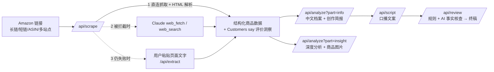

# AI 产品分析助手

> 粘贴一个 Amazon 商品链接 → **产品信息整理 · 深度产品分析 · 短视频口播文案 · 事实与合规质检**

- 在线体验：`<部署后填写 Vercel 地址>`
- 技术栈：Next.js 16（App Router）+ TypeScript + Tailwind CSS 4 · Claude（官方 `@anthropic-ai/sdk`：结构化输出、图片理解、联网工具）· Vercel

## 功能

| 输出 | 内容 |
| --- | --- |
| ① 产品信息整理 | 中文品名、品类、一句话说明、价格（现价/划线价/折扣）、口碑（评分、评分数、销量、榜单排名）、核心功能、关键规格（英制自动附公制换算）、款式 |
| ② 产品分析 | 产品定位与价格带、目标用户（画像 / 需求 / 下单时刻）、使用场景、痛点 → 解决方案、按说服力排序的核心卖点（附证据和证据强度）、买家声音、购买顾虑与应对、竞争格局、内容策略、商品图片洞察 |
| ③ 口播文案 | ≤150 字中文口播，开头一句就是钩子（5 秒内说完），附分镜（时间 / 口播 / 画面）、标题、话题标签、备选钩子，可在浏览器里直接试听 |
| ④ 质量检查 | 规则引擎（字数 / 5 秒钩子 / 广告法用语 / 数字溯源）+ AI 逐条事实核查（有依据 / 无依据 / 夸大 / 与资料不符）+ 合规扫描 → 自动修正出终稿，并展示修改对比 |

另外还有：抓取被拦截时的手动粘贴模式、分阶段进度和单阶段重试、"换一版"文案、历史记录、Markdown 报告导出。

## 架构



深度分析（最慢的一步）和"信息整理 → 文案 → 质检"链路**并行执行**；每一步是独立的 API 调用，所以单步失败可以单独重试，也不会碰到 Serverless 函数的时长上限。

## 设计思路

### 1. 商品信息获取：多级兜底，不针对特定页面适配

Amazon 同时在跑好几套页面布局，还有反爬。我的做法：

- **多套选择器 + 页面内嵌 JSON**：标题、价格、评分、星级分布、类目、BSR、卖点、规格（overview / tech spec / detail bullets / product facts 四种布局）、描述、A+、成分与安全信息、包装清单；图片从 `colorImages` JSON 取，款式从 `variationValues` JSON 取。
- **挖出了 "Customers say" 评价洞察**：Amazon 把评价摘要组件的数据以 base64 JSON 的形式藏在 HTML 注释里（`<!-- k-injected k+b64 … -->`）。通用地解码这些注释，就能拿到 Amazon 对全部评价的 AI 总结、各评价维度（如 ease of cleaning）的正 / 负 / 褒贬不一倾向、提及次数和买家原话。这是产品分析里最有说服力的证据来源。
- **强制英文页面**（`language=en_US` 等）：测试时发现 Amazon 会按服务器 IP 所在地把页面自动翻译成别的语言，强制英文让解析结果不受部署地区影响。
- **反爬识别 + 礼貌重试**：识别验证码页 / 503 拦截页 / 404 下架页，像回访用户一样（同一浏览器标识 + 保留会话 cookie）最多重试 3 次。**不做**验证码破解或代理轮换。
- **兜底 1：Claude 联网工具**。直连被拦截时，用 Claude 的服务端 `web_fetch` 读取页面，读不到再 `web_search` 按 ASIN 搜索，并要求核对是同一商品；页面明确 404 时不允许用搜索结果冒充。
- **兜底 2：手动粘贴**。用户把商品页文字粘进来，Claude 抽取成同样的结构，后续流程不变。
- 支持长链接、带 ref 参数的搜索结果链接、`a.co` / `amzn.to` 短链、裸 ASIN、21 个 Amazon 站点。
- 用 10 个不同品类的真实商品页验证解析器：智能音箱、图书、护肤品、电压力锅、空气炸锅、鼠标、洞洞鞋、电视棒、耳机、露营椅。在售商品的标题、评分、卖点、规格、图片、评价洞察都能取到；类目在 Amazon 自营设备页上没有面包屑导航，这时交给 AI 推断。

### 2. 产品分析：回答"为什么买"，而且每个判断都能追溯

- 分析维度是按内容团队的实际问题设计的：谁会买、在什么时刻下单、解决什么问题、买家真实反馈、跟什么比、怎么讲 / 不能怎么讲。不是罗列参数。
- **每条判断都带来源标签**：`[评价·ease of cleaning 1849次提及]`、`[规格]`、`[A+]`、`[图片]`，推断要标 `[推断]`；卖点标"证据强 / 中 / 弱"。
- 评价维度里的"褒贬不一 / 负面"会被当作购买顾虑和内容雷区，1-2 星占比当作风险信号。
- 最多把 4 张商品图（缩小到约 800px 省 token）交给 Claude，让它看外观、材质、使用场景和图上印的卖点文字，并给出拍摄建议。

### 3. 口播文案：按真实短视频的写法来

- 结构：钩子（0-5s）→ 痛点 / 场景共鸣 → 产品出场 + 2-3 个具体卖点 → 真实背书 → 自然的行动号召。
- Prompt 里给了钩子类型（痛点提问、认知反转、结果前置、场景代入、对比反差），也列出了禁止的开场（"今天给大家推荐""家人们"、先报品牌名）。要求把参数翻译成生活画面，并把英寸、磅换算成国内观众听得懂的单位。
- **字数是硬约束**：由程序计数（含标点），超过 150 字时自动调用压缩，最后还有按句截断兜底。
- 先出一份"创作简报"（人群、痛点、TOP3 卖点、背书、钩子角度）再写文案，所以文案不必等深度分析完成，速度更快。

### 4. 质量检查：规则引擎 + AI 事实核查 + 自动修正

- **规则引擎**（确定性，不依赖模型）：字数、开头一句能否在 5 秒内说完、开场是否套话、《广告法》绝对化用语 / 功效承诺 / 虚假紧迫、文案中的数字能否在商品资料里找到。
- **AI 核查**：把文案拆成一条条事实性表述，逐条对照商品资料，标为有依据、无依据、夸大或与资料不符，并给出改法。另外做合规扫描和钩子点评。
- 输出修正后的**终稿**，界面上用红删绿增的方式对比初稿和终稿，终稿再跑一遍规则检查。

### 5. 工程细节

- 结构化输出：每个阶段都用 zod 定义 schema，Claude 按 JSON Schema 生成，服务端再校验一次。
- Prompt 注入防护：商品数据包在 `<product_data>` 标签里，并声明为数据而不是指令。浏览器回传的商品数据会在服务端重新校验并截断。
- 缓存（同一商品 30 分钟内再次分析直接返回）、按 IP 限流、错误信息翻译成可操作的中文提示。
- 模型默认 `claude-opus-5-5`，可通过环境变量切换。默认开启服务端拒答回退（server-side fallback）。

## 目录结构

```
src/
  app/
    page.tsx                 页面入口
    api/scrape/              链接 → 商品数据（直连 / Claude 联网兜底）
    api/extract/             手动粘贴 → 商品数据
    api/analyze/             part=info 中文档案+简报；part=insight 深度分析（含图片）
    api/script/              口播文案
    api/review/              质检 + 终稿
  lib/
    amazon/url.ts            链接解析（短链、多站点、ASIN）
    amazon/fetch.ts          抓取、反爬识别、重试
    amazon/parse.ts          HTML 解析 + 评价洞察解码 + 完整度
    ai/schemas.ts            各阶段输出 schema（zod）
    ai/prompts.ts            各阶段 system prompt
    ai/stages.ts             AI 流水线
    ai/extract.ts            联网兜底 / 粘贴抽取
    quality/rules.ts         规则引擎
  components/                界面组件
scripts/
  parse-fixtures.ts          用保存的商品页批量测试解析器
  try-fetch.ts               实测抓取（耗时、重试过程）
  run-pipeline.ts            命令行跑完整流水线并保存每一步输出
```

## 本地运行

```bash
npm install
cp .env.example .env.local   # 填入 ANTHROPIC_API_KEY
npm run dev                  # http://localhost:3000
```

没有配置 Key 时也能运行，此时只做商品抓取和解析，AI 部分会提示未配置。

命令行批量测试：

```bash
npx tsx --env-file=.env.local scripts/run-pipeline.ts https://www.amazon.com/dp/B07FDJMC9Q B0014C0LSY
```

## 部署

部署到 Vercel，在环境变量里设置 `ANTHROPIC_API_KEY`，其他配置都用默认值。详细步骤见 [DEPLOY.md](DEPLOY.md)。

## 已知限制

- Amazon 的反爬对云服务器 IP 更严格。直连失败时会自动走 Claude 联网兜底，再不行可以手动粘贴，但这两种方式拿到的字段可能比直连少。
- 价格、库存跟配送地区有关。服务器部署在美国区时价格最完整。
- 深度分析用 Opus 级模型大约需要 30-60 秒。设置 `ANTHROPIC_MODEL=claude-sonnet-5-5` 会更快、更便宜。
